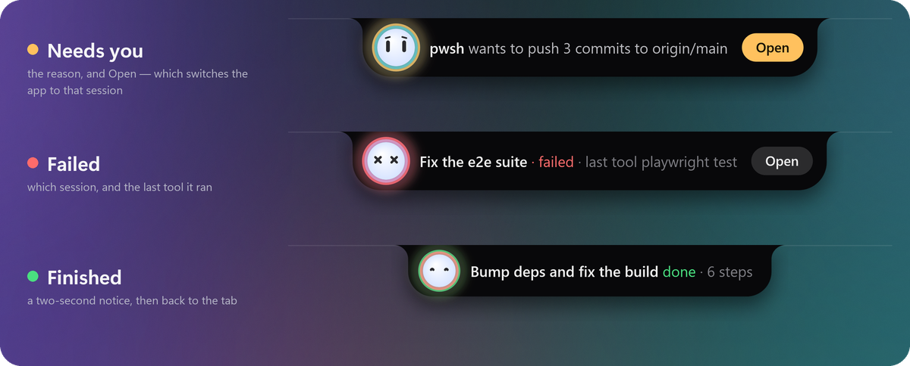
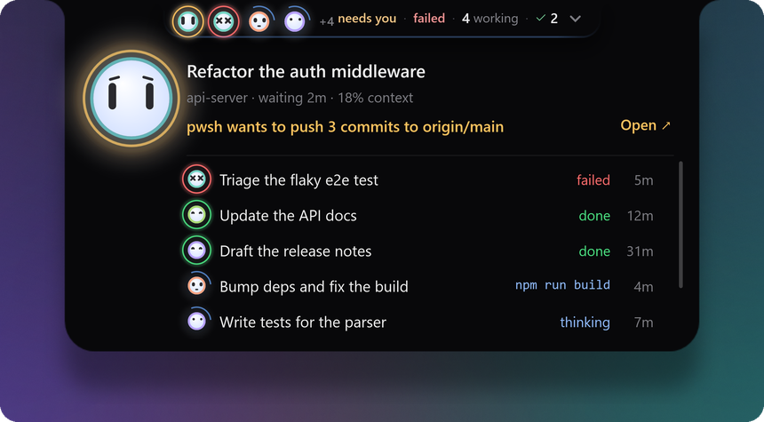

<div align="center">


<br>

**An always-on-top notch for [DeepSeek Harness](https://github.com/deepseek-ai/deepseek-harness)
that answers one question: which of my sessions needs me right now?**

[](https://www.npmjs.com/package/dsh-agents-notch)
[](https://github.com/topics/dsh-plugin)
[](#requirements)
[](LICENSE)

[Install](#install) · [What it shows](#what-it-shows) · [Configure](#configure) · [Limits](#limits-stated-plainly) · [Develop](#develop) · [中文](#中文)

<br>


<sub>Recorded from the window itself (<code>--record</code>), frame by frame — not a mock-up.</sub>

</div>

<br>

## Why

If you run more than a couple of sessions, finding out whether anything is waiting on you costs a
context switch every time:

| what you do today | what it costs |
|---|---|
| alt-tab between windows and read each sidebar | the thing you were doing, every time |
| wait for a desktop notification | one per session, and none of them say which one is *blocked* |
| leave the sidebar visible | it is only visible when the app is in front — which is when you do not need it |

The notch is a small always-on-top tab that **never takes focus**, **hides under a full-screen app**, and
shows the one thing the sidebar cannot while you are in another window: **a session stuck on you**. When
one gets stuck, the tab grows into an alert that says why, with an **Open** button that switches the app
to that session — from wherever it is, minimized or in the tray. Hover the tab and the board unfolds.

## What it shows

<p align="center">
  
</p>

That strip is the whole visual language. **Working** wears a slow blue arc and nothing else, because
working is the quiet default — and while any session is running a tool, light runs along the tab's lower
edge. **Needs you** wears amber, **done** green, **failed** red. Every session keeps its own colour on the
bot's rim, so three sessions read as three sessions rather than three copies of one.

### The tab speaks up

<p align="center">
  
</p>

When something **new** happens — a session asks for you, fails, or finishes — the tab grows into an
alert for a few seconds and then folds back. **Open** takes you straight to that session. Only fresh
events are announced: a question that has been waiting for an hour is on the board, not in your face.

### The board

<p align="center">
  
</p>

Hover the tab and the board unfolds. At the top is the session that **changed most recently**, so a
finish or a question is what you see first: its title, its project and age, how full its context is, and
one line of what it is doing — the tool it is running and the step, the question it is asking in full,
or how it ended. Below it, every other session in one list: what it is doing in a word and how long ago.
More sessions than fit? The list scrolls.

**Click** a row to put that session on the big bot. **Double-click** a row, or press **Open ↗**, and the
app switches to it. A finished or failed row has a **✕** that closes it out — the same as ticking it in
the app.

### Sixteen faces

<p align="center">
  
</p>

The bot's face is the state, read closer. A working bot is **focused** in a tool and **thinking** between
tools, **determined** on a long busy turn and **tired** after half an hour; it is **confused** when a tool
just failed and **dizzy** when they keep failing. It **pleads** when it needs you, squints `^^` when it is
done, and falls **asleep** when the host goes quiet. It blinks, follows your pointer with its eyes, and
plays a short motion on each change — once, and then it rests. A board that keeps celebrating something
that finished an hour ago is noise.

<table>
<tr>
<td width="33%" valign="top">

**🫥 Never in the way**<br>
Topmost, but never takes focus. Clicks pass through everywhere it is not drawn. Hides under a
full-screen app.

</td>
<td width="33%" valign="top">

**↗️ Open goes there**<br>
Open, or a double-click, switches DeepSeek Harness to that session and brings it to the front — out of
the taskbar or the tray.

</td>
<td width="33%" valign="top">

**📏 Honest numbers**<br>
No context percentage without a real budget, no "2m ago" without a timestamp, and a grey tab when
the host stops answering.

</td>
</tr>
<tr>
<td valign="top">

**🎛️ A Settings pane of its own**<br>
Settings → Agents Notch: size, anchor, display, rows, opacity, motion. A change lands on the next
tick — nothing restarts.

</td>
<td valign="top">

**🧘 Respects reduce-motion**<br>
`motion: auto` follows Windows. With it off you get each state's settled face and nothing else.

</td>
<td valign="top">

**📦 One command, no runtime**<br>
~30 KB of JavaScript. The window fetches itself from the matching GitHub release, hash-verified — one
self-contained file, no .NET to install.

</td>
</tr>
</table>

## Requirements

- **Windows 10/11, x64.** The window is WPF and Win32 (topmost, no-activate, fullscreen detection):
  there is no macOS or Linux build. `package.json` declares `"os": ["win32"]`.
- **DeepSeek Harness.** Built and verified on **0.2.1-rc.2**. The host half reads `session/event`
  (`{ global: true }`), `ctx.webServer`, `ctx.agents` and `sessionQuery`, and the in-app half uses
  `uiWorkspace`; an older build may lack one. Nothing is checked before mounting — see
  [*Limits*](#limits-stated-plainly).
- **Node ≥ 22** for the plugin. **No .NET runtime**: the released window is self-contained.
- Optional: the **`session-finished`** plugin, which is what retires a finished row
  ([*What earns a row*](#what-earns-a-row)).

## Install

```powershell
dsh plugin --profile web add dsh-agents-notch
```

Running the harness under another profile? Put its name in place of `web`.

The plugin is ~30 KB. The first time it runs, it downloads its window (one 65 MB file, no .NET runtime
needed) from this repo's GitHub release and checks it against the published SHA-256. A few seconds later
the notch is at the top of your screen.

**No notch?** Look at the last line of `$DSH_HOME\state\agents-notch\host-report.jsonl`: it says where
the host looked for the window, whether the download worked, and the command that fixes it.

## Configure

**The notch has a pane of its own: Settings → Agents Notch.** Size, anchor, display, rows, opacity,
motion and the text switches live there, and a change lands on the notch immediately — the window
re-reads its state on the next tick, so nothing restarts.

Three layers decide a value, each beating the one above it:

1. the built-in defaults;
2. the plugin row's `config:` — the file you edit, which nothing overwrites;
3. `$DSH_HOME/state/agents-notch/settings.json`, written by the pane, one click at a time.

Both doors are clamped by the same rules, so a slider and a YAML line behave identically. *Reset* in
the pane clears the third layer and the row decides again. The pane keeps its own file because a
browser cannot safely rewrite YAML that other sessions also edit.

<details>
<summary><b>Every key, and how to set it in YAML</b></summary>

<br>

Defaults live in the package's own `cordis.patch.yml`. To change one, put a row **with the same id**
in your profile's patch layer (`$DSH_HOME/profiles/web/cordis.patch.yml`) — a row without `insert:` is
an override of a row that already exists:

```yaml
- id: agents-notch
  config:
    contextBudget: 1000000     # your route's context window, in tokens
    anchor: top-right
    scale: 1.25
```

| key | default | meaning |
|---|---|---|
| `spawnWindow` | `true` | `false` runs the host without a window — useful for tests |
| `pollMs` | `340` | how often the state file is rebuilt |
| `maxRows` | `6` | 3–10, how many sessions the board shows before its list scrolls |
| `contextBudget` | `null` | your route's context window in tokens; `null` = unknown (see below) |
| `contextHotAt` | `0.5` | the fraction where the bar turns amber — the route's compaction trigger |
| `anchor` | `top-center` | `top-center` · `top-left` · `top-right` |
| `screen` | `primary` | `primary` · `cursor` · `1` · `2` … (as Windows numbers them) |
| `scale` | `1` | 0.75–2 |
| `hideFullscreen` | `true` | hide under a full-screen app |
| `opacity` | `1` | 0.35–1, how much of the desktop the notch sits in front of |
| `motion` | `auto` | `auto` follows Windows' reduce-motion setting; `on` forces the animation, `off` draws each state's settled face and nothing else |
| `showProject` | `true` | the project name in the headline's sub line |
| `showDone` | `true` | `false` keeps finished sessions off the board entirely (and out of the count) |
| `finishedFallbackMs` | `900000` | how long a settled row survives when `session-finished` is absent |
| `stateDir` | `$DSH_HOME/state/agents-notch` | where the state file, the logs and the window live |
| `exePath` | — | force one window binary |
| `autoDownload` | `true` | fetch the window from the release when it is missing |
| `downloadUrl` | — | fetch from a mirror instead of the release |

</details>

### Honest numbers

`contextBudget` is **not** guessed. The context window belongs to the model route, and nothing in
the session feed carries it, so this plugin defaults it to `null` — and with `null` you get a token
count and no percentage, no bar and no amber. A percentage against an invented denominator is a lie
that looks like information, which is worse than a number with units.

<p align="center">
  
</p>

Set it to your route's real window (this build's DeepSeek V4 routes: `1000000`) and the percentage and
the bar appear.

## What earns a row

A session is on the board because **something happened to it**: it is working, it is blocked on an
approval or a question, it failed, or it finished and you have not closed it out. Merely being open
never earns a row, however many sessions are attached.

Finished and failed rows do not expire on a timer. They leave when the harness's own close-out
verdict says so — the ✓ that the **`session-finished`** plugin puts in the sidebar, read over that
plugin's HTTP route, or the ✕ on the row. If that plugin is not installed, this one notices after three
failed probes and retires settled rows after 15 minutes instead, and says so in its report
(`host-report.jsonl`).

When the host stops answering, the board stops pretending — the tab goes grey, the bot falls asleep,
and the sub line dates the last heartbeat instead of repeating a summary nobody is updating:

<p align="center">
  
</p>

## Limits, stated plainly

- **Windows only**, x64. No macOS or Linux build, and no partial one.
- **No DSH version is declared in the manifest**, so nothing gates a wrong install. It was built and
  tested on `0.2.1-rc.2`; if a field is missing on your build, the host keeps serving and the log
  says what failed rather than the tab lying.
- **Open needs the app's own window.** It switches sessions through the plugin's in-app half, so the app
  has to be running; the notch can bring its window back from the taskbar or the tray, but it cannot
  start the app.
- **`session-finished` is optional but recommended** — without it, closed-out sessions linger for
  the 15-minute fallback.
- **The window is not draggable**, by design: it is a fixed surface at the top of the screen, and a
  draggable one got dragged by accident. Move it with `anchor` and `screen`.
- **Two windows cannot coexist** — a named mutex makes the second instance exit.
- **The binary is unsigned**, so SmartScreen warns the first time you run it.
- **Quitting it from the tray is a one-hour dismissal, not forever**: the host brings the notch back,
  because a status board that can be lost by accident is worse than one that returns.

## Uninstall

```powershell
dsh plugin --profile web remove dsh-agents-notch
Remove-Item -Recurse "$env:DSH_HOME\state\agents-notch"    # state, logs, window binary, unpack cache
```

## Develop

```powershell
npm test                      # 65 tests, node --test, no harness, no window, no network
npm run window:build          # dotnet build desktop/AgentsNotch.csproj -c Release
npm run window:publish        # self-contained single file + SHA256 into dist/win-x64

# a still of the board, from a fixture, without a harness:
desktop/bin/Release/net9.0-windows/AgentsNotch.exe --state desktop/fixtures/working.json --open --shot dist/shots/working.png
```

The window takes `--shot`, `--record`, `--open`, `--freeze`, `--face <name>`, `--island x1|x4|d1`,
`--log`, `--fps`, `--no-effects` and `--probe-rect`, and `desktop/fixtures/` holds schema-4 state
files, so every state, face and alert can be photographed with no harness running. Every picture in this
README is drawn by the window itself: `python tools/readme-media.py shots|record|art` renders the
stills, records the demo frame by frame on the window's own clock, and lays them out.

**Installing the window by hand** (offline, or a build of your own): `autoDownload: false` in the
plugin row turns the download off, `downloadUrl: <url>` points it at a mirror, and
`tools/install-window.ps1 -Url <release asset>` or `-FromPath dist\win-x64` puts a window where the
host looks for one.

- [`docs/CONTRACT.md`](docs/CONTRACT.md) — the interface between the two halves; frozen, and both
  halves and the tests are written against it.
- [`docs/INTERNALS.md`](docs/INTERNALS.md) — the engineering record: every measurement that decided
  a shape, and the traps that cost a day each. The most useful file here if you change something.
- [`CHANGELOG.md`](CHANGELOG.md) — what changed, per version.
- [`docs/PUBLISHING.md`](docs/PUBLISHING.md) — the checklist for cutting a release.

## 中文

**Agents Notch** 是一个 DeepSeek Harness 插件：在屏幕顶部挂一个始终置顶的“刘海”，每个会话一个小机器人，一眼就能看出
**哪个会话正在等你**。

- **工作中**是缓慢转动的蓝色弧线，正在调用工具时标签底边会有光流过；**需要你**是琥珀色光圈；**完成**是绿色光圈和 `^^` 表情；**失败**是红色光圈和 `x x` 表情。
- 有会话需要你、失败或完成时，标签会短暂展开成提示，显示原因和 **Open** 按钮——一键切换到该会话，即使应用最小化或在托盘里。
- 鼠标悬停即展开面板：最新变化的会话在顶部（标题、项目、上下文用量、正在运行的工具或等待的问题），其余会话列在下方，超出时可滚动。单击一行在大机器人上查看，双击或 **Open ↗** 切换到该会话。
- 机器人有十六种表情：思考、专注、疲惫、困惑、恳求、完成、睡着……
- 从不抢焦点，全屏应用下自动隐藏；没有真实的上下文预算就不显示百分比，宿主断开时标签变灰并注明最后心跳时间。
- 设置 → **Agents Notch** 有独立设置页：大小、位置、显示器、行数、不透明度、动效，修改即时生效。

```powershell
dsh plugin --profile web add dsh-agents-notch
```

仅支持 **Windows 10/11 x64**。插件本体约 30 KB，首次运行时会从对应版本的 GitHub Release 自动下载窗口程序并校验 SHA256，无需安装 .NET 运行时。

<br>

<div align="center">
<sub>MIT — see <a href="LICENSE">LICENSE</a> · made for DeepSeek Harness by <a href="https://github.com/iArxic">iArxic</a></sub>
</div>
