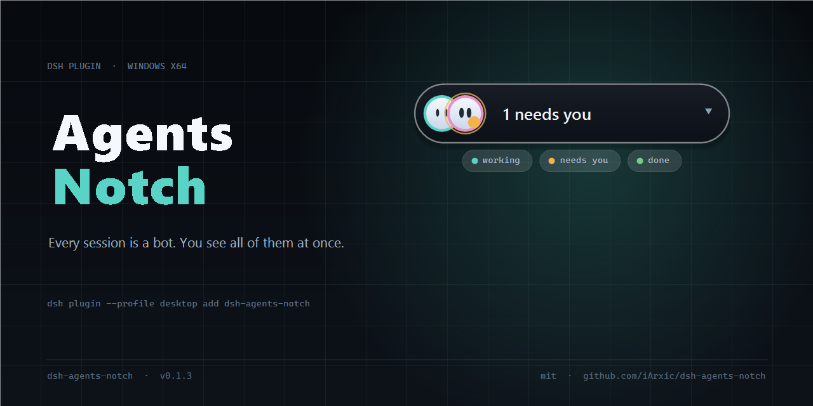
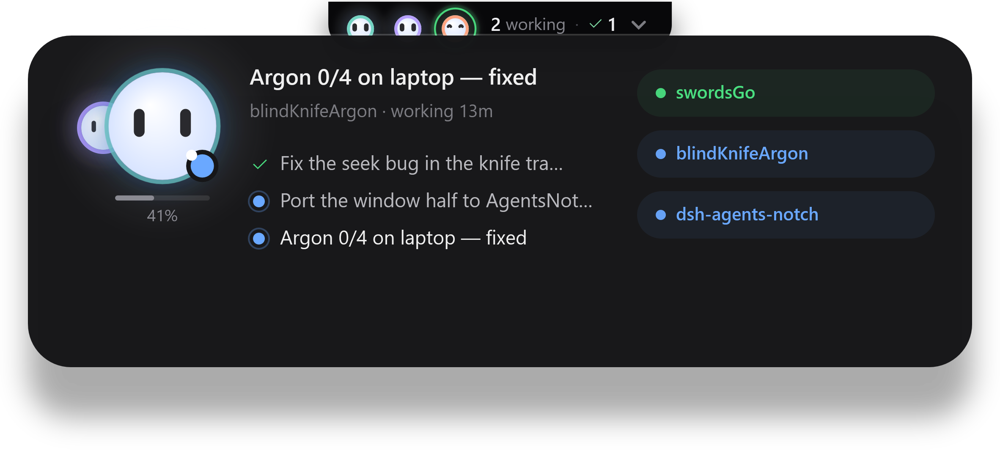
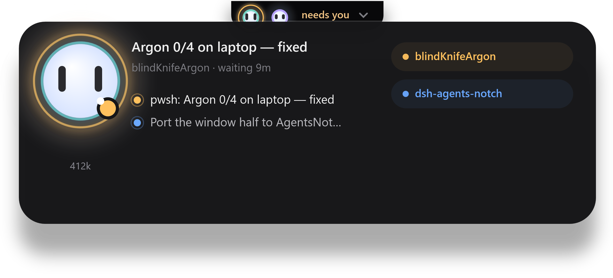
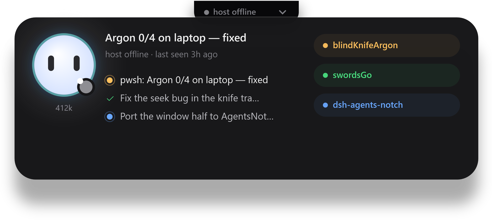

# Agents Notch




**`dsh-agents-notch`** — an always-on-top notch for [DeepSeek Harness](https://github.com/deepseek-ai/deepseek-harness)
that answers one question: **which of my sessions needs me right now?**



One bot per session; hover and the board unfolds: who is working, who is waiting on you, who failed,
who finished and you have not looked yet.


That strip is the whole visual language, and it is what the tab says at a glance: **working** has no
ring (working is the quiet default), **needs you** wears an amber ring and a `?`, **failed** a red
ring, and **host offline** means the harness stopped answering — not that everything is fine.

## Why

If you run more than a couple of sessions, the answer to "is anything waiting on me?" is currently
one of these, and all of them cost a context switch:

| what you do today | what it costs |
|---|---|
| alt-tab between windows and read each sidebar | the thing you were doing, every time |
| wait for a desktop notification | one per session, and none of them say which one is *blocked* |
| leave the sidebar visible | it is only visible when the app is in front — which is when you do not need it |

The notch is 220×30 px of always-on-top that never takes focus, hides under a full-screen app, and
shows the one thing the sidebar cannot while you are in another window: **a session stuck on you**.
With a single session it is a decoration; that is stated under *Limits* rather than glossed over.

## Requirements

- **Windows 10/11, x64.** The window is WPF and Win32 (topmost, no-activate, fullscreen detection):
  there is no macOS or Linux build. `package.json` declares `"os": ["win32"]`.
- **DeepSeek Harness.** Built and verified on **0.2.1-rc.2**. The host half reads `session/event`
  (`{ global: true }`), `ctx.webServer`, `ctx.agents` and `sessionQuery`; an older build may lack a
  field. Nothing is checked before mounting — see *Limits*.
- **Node ≥ 22** for the plugin. **No .NET runtime**: the released window is self-contained.
- Optional: the **`session-finished`** plugin, which is what retires a finished row (*What earns a
  row*).

## Install

**One command**, like every other DSH plugin:

```powershell
dsh plugin --profile <profile> add dsh-agents-notch     # or the app's own plugin manager
```

That is the whole install. The plugin is ~30 KB of JavaScript; the 65 MB window does not ride in the
tarball, because every version bump would re-upload it and every update re-download it. Instead the
host **fetches the matching release asset itself** the first time it needs a window it cannot find:
`v<version>` of `repository` in the package manifest, hash verified against the `.sha256` published
beside it, written to `$DSH_HOME\state\agents-notch\window\<version>\`. You can watch it happen:

```jsonc
{"event":"window-fetch","url":"https://github.com/<owner>/dsh-agents-notch/releases/download/v0.1.1/AgentsNotch.exe"}
{"event":"window-fetched","bytes":68276826,"verified":true}
{"event":"window-started","pid":6704,"source":"installed"}
```

**What success looks like:** within a couple of seconds of the harness starting, the tab is at the top
of the screen, and `$DSH_HOME\state\agents-notch\state.json` lists your sessions. If the tab does not
appear, that directory holds `host-report.jsonl` — the newest line says which of the five places the
host looked, whether it tried to fetch, and the command that fixes it.

Offline, behind a firewall, or you just prefer to do it by hand? The installer does the same job:

```powershell
pwsh -File "<profile>\node_modules\dsh-agents-notch\tools\install-window.ps1" `
     -Url https://github.com/<owner>/dsh-agents-notch/releases/download/v0.1.1/AgentsNotch.exe
# or from a checkout you built yourself:
pwsh -File tools\install-window.ps1 -FromPath dist\win-x64
```

`autoDownload: false` in the plugin row turns the fetch off; `downloadUrl: <url>` points it at a
mirror. The release is **one 65 MB file** with no prerequisites — no .NET runtime. Being one file, it
unpacks its native libraries on first run, and the plugin points that unpack at `<stateDir>\bundle`
rather than `%TEMP%`: measured on a normal Windows 11 box, the default unpack directory could not be
created (error 5) and the app died before drawing anything, with no message a user would ever see.
## Configure
**The notch has a pane of its own: Settings → Agents Notch.** Size, anchor, display, rows, opacity,
motion and the three text switches live there, and a change lands on the notch immediately — the window
re-reads its state on the next tick, so nothing restarts.

Three layers decide a value, each beating the one above it:

1. the built-in defaults;
2. the plugin row's `config:` below — the file you edit, which nothing overwrites;
3. `$DSH_HOME/state/agents-notch/settings.json`, written by the pane, one click at a time.

Both doors are clamped by the same rules, so a slider and a YAML line behave identically, and a value
the pane writes is stored in its clamped form — the file always says what the window does. *Reset* in
the pane clears that third layer and the row decides again. The pane keeps its own file because a
browser cannot safely rewrite YAML: editing `cordis.patch.yml` from a UI would round-trip a file other
sessions also edit.


Defaults live in the package's own `cordis.patch.yml`. To change one, put a row **with the same id**
in your profile's patch layer (`$DSH_HOME/profiles/<profile>/cordis.patch.yml`) — a row without
`insert:` is an override of a row that already exists:

```yaml
- id: agents-notch
  config:
    contextBudget: 1000000     # your route's context window, in tokens
    anchor: top-right
    scale: 1.25
```

| key | default | meaning |
|---|---|---|
| `spawnWindow` | `true` | `false` runs the host without a window — useful for tests |
| `pollMs` | `340` | how often the state file is rebuilt |
| `maxRows` | `6` | 3–10, how many sessions the board may show |
| `contextBudget` | `null` | your route's context window in tokens; `null` = unknown (see below) |
| `contextHotAt` | `0.5` | the fraction where the bar turns amber — the route's compaction trigger |
| `anchor` | `top-center` | `top-center` · `top-left` · `top-right` |
| `screen` | `primary` | `primary` · `cursor` · `1` · `2` … (as Windows numbers them) |
| `scale` | `1` | 0.75–2 |
| `hideFullscreen` | `true` | hide under a full-screen app |
| `opacity` | `1` | 0.35–1, how much of the desktop the notch sits in front of |
| `motion` | `auto` | `auto` follows Windows' reduce-motion setting; `on` forces the animation, `off` draws the settled pose and nothing else |
| `showProject` | `true` | the project name in the sub line (the colour chips at right stay) |
| `showDone` | `true` | `false` keeps finished sessions off the board entirely (and out of the count) || `finishedFallbackMs` | `900000` | how long a settled row survives when `session-finished` is absent |
| `stateDir` | `$DSH_HOME/state/agents-notch` | where the state file, the log and the window live |
| `exePath` | — | force one window binary |
| `autoDownload` | `true` | fetch the window from the release when it is missing |
| `downloadUrl` | — | fetch from a mirror instead of the release |

### Honest numbers

`contextBudget` is **not** guessed. The context window belongs to the model route, and nothing in
the session feed carries it, so this plugin defaults it to `null` — and with `null` you get a token
count and no percentage, no bar and no amber. A percentage against an invented denominator is a lie
that looks like information, which is worse than a number with units.



Set it to your route's real window (this build's DeepSeek V4 routes: `1000000`) and the bar appears.

## What earns a row

A session is on the board because **something happened to it**: it is working, it is blocked on an
approval or a question, it failed, or it finished and you have not closed it out. Merely being open
never earns a row, however many sessions are attached.

Finished and failed rows do not expire on a timer. They leave when the harness's own close-out
verdict says so — the ✓ that the **`session-finished`** plugin puts in the sidebar, read over that
plugin's HTTP route. If it is not installed, this one notices after three failed probes and retires
settled rows after 15 minutes instead, and says so in the tooltip. Nothing on a row decays on its
own: a field that changed with nothing having happened would be the one untrustworthy thing on the
board.

When the host stops answering, the board stops pretending — the tab goes grey and the sub line dates
the last heartbeat instead of repeating a summary nobody is updating:



## Limits, stated plainly

- **Windows only**, x64. No macOS or Linux build, and no partial one.
- **No DSH version is declared in the manifest**, so nothing gates a wrong install. It was built and
  tested on `0.2.1-rc.2`; if a field is missing on your build, the host keeps serving and the log
  says what failed rather than the tab lying.
- **`session-finished` is optional but recommended** — without it, closed-out sessions linger for
  the 15-minute fallback.
- **The window is not draggable**, by design: it is a fixed surface at the top of the screen, and a
  draggable one got dragged by accident. Move it with `anchor` and `screen`.
- **Two windows cannot coexist** — a named mutex makes the second instance exit.
- **The binary is unsigned**, so SmartScreen warns the first time you run it.
- **Quitting it from the tray is a one-hour dismissal, not forever**: the host brings the notch back,
  because a status board that can be lost by accident is worse than one that returns.

## Uninstall

```powershell
dsh plugin --profile <profile> remove dsh-agents-notch     # or the app's plugin manager
Remove-Item -Recurse "$env:DSH_HOME\state\agents-notch"    # state, log, window binary, unpack cache
```

## Develop

```powershell
npm test                      # 43 tests, node --test, no harness, no window, no network
npm run window:build          # dotnet build desktop/AgentsNotch.csproj -c Release
npm run window:publish        # self-contained single file + SHA256 into dist/win-x64

# a still of the board, from a fixture, without a harness:
desktop/bin/Release/net9.0-windows/AgentsNotch.exe --state desktop/fixtures/working.json --open --shot dist/shots/working.png
```

The window takes `--shot`, `--open`, `--freeze`, `--log`, `--fps`, `--no-effects` and `--probe-rect`,
and `desktop/fixtures/` holds schema-3 state files, so every state can be photographed with no
harness running.

- [`docs/CONTRACT.md`](docs/CONTRACT.md) — the interface between the two halves; frozen, and both
  halves and the tests are written against it.
- [`docs/INTERNALS.md`](docs/INTERNALS.md) — the engineering record: every measurement that decided
  a shape, and the traps that cost a day each. The most useful file here if you change something.
- [`CHANGELOG.md`](CHANGELOG.md) — what changed, per version.
- [`docs/PUBLISHING.md`](docs/PUBLISHING.md) — the checklist for cutting a release.

MIT — see [LICENSE](LICENSE).
