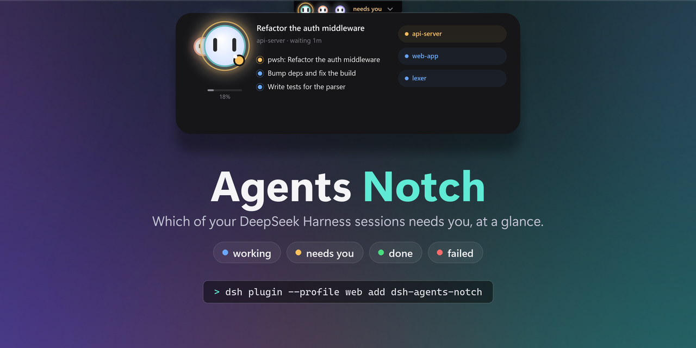
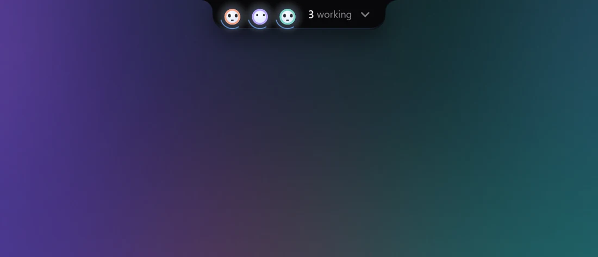
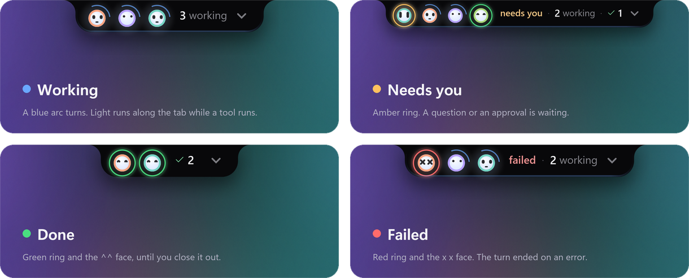
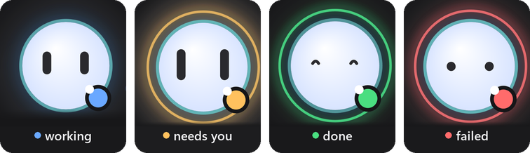
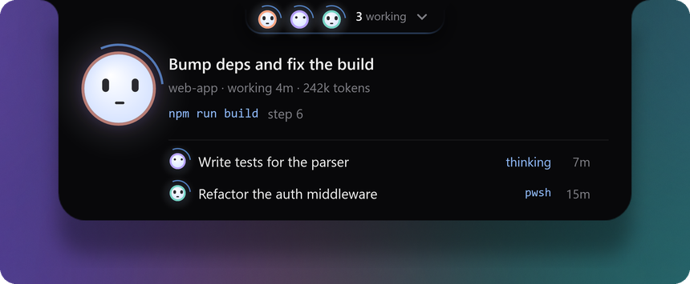
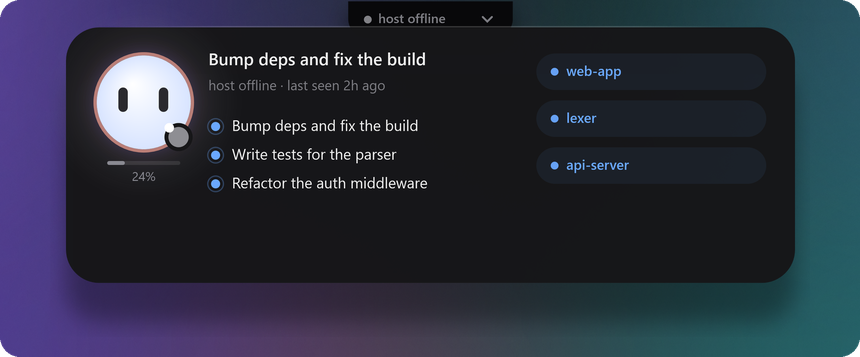

<div align="center">



<br>

**An always-on-top notch for [DeepSeek Harness](https://github.com/deepseek-ai/deepseek-harness)
that answers one question: which of my sessions needs me right now?**

[](https://www.npmjs.com/package/dsh-agents-notch)
[](https://github.com/topics/dsh-plugin)
[](#requirements)
[](LICENSE)

[Install](#install) · [What it shows](#what-it-shows) · [Configure](#configure) · [Limits](#limits-stated-plainly) · [Develop](#develop) · [中文](#中文)

<br>



<sub>Recorded from the window itself (<code>--record</code>), frame by frame — not a mock-up.</sub>

</div>

<br>

## Why

If you run more than a couple of sessions, finding out whether anything is waiting on you costs a
context switch every time:

| what you do today | what it costs |
|---|---|
| alt-tab between windows and read each sidebar | the thing you were doing, every time |
| wait for a desktop notification | one per session, and none of them say which one is *blocked* |
| leave the sidebar visible | it is only visible when the app is in front — which is when you do not need it |

The notch is 220×30 px of always-on-top that **never takes focus**, **hides under a full-screen app**,
and shows the one thing the sidebar cannot while you are in another window: **a session stuck on you**.
Hover it and the board unfolds — who is working, who is waiting on you, who failed, who finished and
you have not looked yet. Double-click the tab or a row and DeepSeek Harness comes to the front.

## What it shows

<p align="center">
  
</p>

That strip is the whole visual language. **Working** has no ring, because working is the quiet
default. **Needs you** wears amber, **done** wears green and the `^^` face, **failed** wears red. Every
session keeps its own colour on the bot's rim, so three sessions read as three sessions rather than
three copies of one.

<p align="center">
  
</p>

The big bot on the board wears whichever session **changed most recently**, so a finish or a
question is what you see first. It blinks, follows your pointer with its eyes, widens them when a
session asks for you, and squints `^^` when one is done — once, and then it rests. A board that keeps
celebrating something that finished an hour ago is noise.

<table>
<tr>
<td width="33%" valign="top">

**🫥 Never in the way**<br>
Topmost, but never takes focus. Clicks pass through everywhere it is not drawn. Hides under a
full-screen app.

</td>
<td width="33%" valign="top">

**📏 Honest numbers**<br>
No context percentage without a real budget, no "2m ago" without a timestamp, and a grey tab when
the host stops answering.

</td>
<td width="33%" valign="top">

**🎛️ A Settings pane of its own**<br>
Settings → Agents Notch: size, anchor, display, rows, opacity, motion. A change lands on the next
tick — nothing restarts.

</td>
</tr>
<tr>
<td valign="top">

**📦 One command to install**<br>
~30 KB of JavaScript. The window fetches itself from the matching GitHub release, hash-verified.

</td>
<td valign="top">

**🧘 Respects reduce-motion**<br>
`motion: auto` follows Windows. With it off you get the settled pose and nothing else.

</td>
<td valign="top">

**🖥️ No runtime to install**<br>
The window is one self-contained file. No .NET runtime, no prerequisites.

</td>
</tr>
</table>

## Requirements

- **Windows 10/11, x64.** The window is WPF and Win32 (topmost, no-activate, fullscreen detection):
  there is no macOS or Linux build. `package.json` declares `"os": ["win32"]`.
- **DeepSeek Harness.** Built and verified on **0.2.1-rc.2**. The host half reads `session/event`
  (`{ global: true }`), `ctx.webServer`, `ctx.agents` and `sessionQuery`; an older build may lack a
  field. Nothing is checked before mounting — see [*Limits*](#limits-stated-plainly).
- **Node ≥ 22** for the plugin. **No .NET runtime**: the released window is self-contained.
- Optional: the **`session-finished`** plugin, which is what retires a finished row
  ([*What earns a row*](#what-earns-a-row)).

## Install

```powershell
dsh plugin --profile web add dsh-agents-notch
```

Running the harness under another profile? Put its name in place of `web`.

The plugin is ~30 KB. The first time it runs, it downloads its window (one 65 MB file, no .NET runtime
needed) from this repo's GitHub release and checks it against the published SHA-256. A few seconds later
the notch is at the top of your screen.

**No notch?** Look at the last line of `$DSH_HOME\state\agents-notch\host-report.jsonl`: it says where
the host looked for the window, whether the download worked, and the command that fixes it.

## Configure

**The notch has a pane of its own: Settings → Agents Notch.** Size, anchor, display, rows, opacity,
motion and the three text switches live there, and a change lands on the notch immediately — the window
re-reads its state on the next tick, so nothing restarts.

Three layers decide a value, each beating the one above it:

1. the built-in defaults;
2. the plugin row's `config:` — the file you edit, which nothing overwrites;
3. `$DSH_HOME/state/agents-notch/settings.json`, written by the pane, one click at a time.

Both doors are clamped by the same rules, so a slider and a YAML line behave identically. *Reset* in
the pane clears the third layer and the row decides again. The pane keeps its own file because a
browser cannot safely rewrite YAML that other sessions also edit.

<details>
<summary><b>Every key, and how to set it in YAML</b></summary>

<br>

Defaults live in the package's own `cordis.patch.yml`. To change one, put a row **with the same id**
in your profile's patch layer (`$DSH_HOME/profiles/<profile>/cordis.patch.yml`) — a row without
`insert:` is an override of a row that already exists:

```yaml
- id: agents-notch
  config:
    contextBudget: 1000000     # your route's context window, in tokens
    anchor: top-right
    scale: 1.25
```

| key | default | meaning |
|---|---|---|
| `spawnWindow` | `true` | `false` runs the host without a window — useful for tests |
| `pollMs` | `340` | how often the state file is rebuilt |
| `maxRows` | `6` | 3–10, how many sessions the board may show |
| `contextBudget` | `null` | your route's context window in tokens; `null` = unknown (see below) |
| `contextHotAt` | `0.5` | the fraction where the bar turns amber — the route's compaction trigger |
| `anchor` | `top-center` | `top-center` · `top-left` · `top-right` |
| `screen` | `primary` | `primary` · `cursor` · `1` · `2` … (as Windows numbers them) |
| `scale` | `1` | 0.75–2 |
| `hideFullscreen` | `true` | hide under a full-screen app |
| `opacity` | `1` | 0.35–1, how much of the desktop the notch sits in front of |
| `motion` | `auto` | `auto` follows Windows' reduce-motion setting; `on` forces the animation, `off` draws the settled pose and nothing else |
| `showProject` | `true` | the project name in the sub line (the colour chips at right stay) |
| `showDone` | `true` | `false` keeps finished sessions off the board entirely (and out of the count) |
| `finishedFallbackMs` | `900000` | how long a settled row survives when `session-finished` is absent |
| `stateDir` | `$DSH_HOME/state/agents-notch` | where the state file, the log and the window live |
| `exePath` | — | force one window binary |
| `autoDownload` | `true` | fetch the window from the release when it is missing |
| `downloadUrl` | — | fetch from a mirror instead of the release |

</details>

### Honest numbers

`contextBudget` is **not** guessed. The context window belongs to the model route, and nothing in
the session feed carries it, so this plugin defaults it to `null` — and with `null` you get a token
count and no percentage, no bar and no amber. A percentage against an invented denominator is a lie
that looks like information, which is worse than a number with units.

<p align="center">
  
</p>

Set it to your route's real window (this build's DeepSeek V4 routes: `1000000`) and the bar appears.

## What earns a row

A session is on the board because **something happened to it**: it is working, it is blocked on an
approval or a question, it failed, or it finished and you have not closed it out. Merely being open
never earns a row, however many sessions are attached.

Finished and failed rows do not expire on a timer. They leave when the harness's own close-out
verdict says so — the ✓ that the **`session-finished`** plugin puts in the sidebar, read over that
plugin's HTTP route. If it is not installed, this one notices after three failed probes and retires
settled rows after 15 minutes instead, and says so in the tooltip.

When the host stops answering, the board stops pretending — the tab goes grey and the sub line dates
the last heartbeat instead of repeating a summary nobody is updating:

<p align="center">
  
</p>

## Limits, stated plainly

- **Windows only**, x64. No macOS or Linux build, and no partial one.
- **No DSH version is declared in the manifest**, so nothing gates a wrong install. It was built and
  tested on `0.2.1-rc.2`; if a field is missing on your build, the host keeps serving and the log
  says what failed rather than the tab lying.
- **`session-finished` is optional but recommended** — without it, closed-out sessions linger for
  the 15-minute fallback.
- **The window is not draggable**, by design: it is a fixed surface at the top of the screen, and a
  draggable one got dragged by accident. Move it with `anchor` and `screen`.
- **Two windows cannot coexist** — a named mutex makes the second instance exit.
- **The binary is unsigned**, so SmartScreen warns the first time you run it.
- **Quitting it from the tray is a one-hour dismissal, not forever**: the host brings the notch back,
  because a status board that can be lost by accident is worse than one that returns.

## Uninstall

```powershell
dsh plugin --profile web remove dsh-agents-notch
Remove-Item -Recurse "$env:DSH_HOME\state\agents-notch"    # state, log, window binary, unpack cache
```

## Develop

```powershell
npm test                      # 60 tests, node --test, no harness, no window, no network
npm run window:build          # dotnet build desktop/AgentsNotch.csproj -c Release
npm run window:publish        # self-contained single file + SHA256 into dist/win-x64

# a still of the board, from a fixture, without a harness:
desktop/bin/Release/net9.0-windows/AgentsNotch.exe --state desktop/fixtures/working.json --open --shot dist/shots/working.png
```

The window takes `--shot`, `--record`, `--open`, `--freeze`, `--log`, `--fps`, `--no-effects` and
`--probe-rect`, and `desktop/fixtures/` holds schema-3 state files, so every state can be photographed
with no harness running. Every picture in this README is drawn by the window itself:
`python tools/readme-media.py shots|record|art` renders the stills, records the demo frame by frame on
the window's own clock, and lays them out.

**Installing the window by hand** (offline, or a build of your own): `autoDownload: false` in the
plugin row turns the download off, `downloadUrl: <url>` points it at a mirror, and
`tools/install-window.ps1 -Url <release asset>` or `-FromPath dist\win-x64` puts a window where the
host looks for one.

- [`docs/CONTRACT.md`](docs/CONTRACT.md) — the interface between the two halves; frozen, and both
  halves and the tests are written against it.
- [`docs/INTERNALS.md`](docs/INTERNALS.md) — the engineering record: every measurement that decided
  a shape, and the traps that cost a day each. The most useful file here if you change something.
- [`CHANGELOG.md`](CHANGELOG.md) — what changed, per version.
- [`docs/PUBLISHING.md`](docs/PUBLISHING.md) — the checklist for cutting a release.

## 中文

**Agents Notch** 是一个 DeepSeek Harness 插件：在屏幕顶部挂一个始终置顶的“刘海”，每个会话一个小机器人，一眼就能看出
**哪个会话正在等你**。

- **工作中**没有光圈（安静的默认状态）；**需要你**是琥珀色光圈；**完成**是绿色光圈和 `^^` 表情；**失败**是红色光圈。
- 鼠标悬停即展开面板：谁在工作、谁在等你审批或回答、谁失败了、谁已完成但你还没看。双击标签或任意一行即可切换到 DeepSeek Harness。
- 从不抢焦点，全屏应用下自动隐藏；没有真实的上下文预算就不显示百分比，宿主断开时标签变灰并注明最后心跳时间。
- 设置 → **Agents Notch** 有独立设置页：大小、位置、显示器、行数、不透明度、动效，修改即时生效。

```powershell
dsh plugin --profile web add dsh-agents-notch
```

仅支持 **Windows 10/11 x64**。插件本体约 30 KB，首次运行时会从对应版本的 GitHub Release 自动下载窗口程序并校验 SHA256，无需安装 .NET 运行时。

<br>

<div align="center">
<sub>MIT — see <a href="LICENSE">LICENSE</a> · made for DeepSeek Harness by <a href="https://github.com/iArxic">iArxic</a></sub>
</div>
